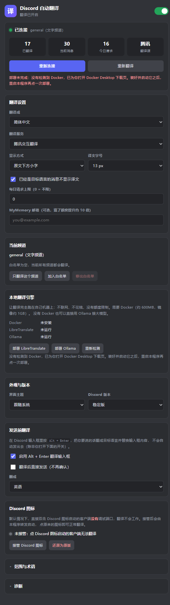
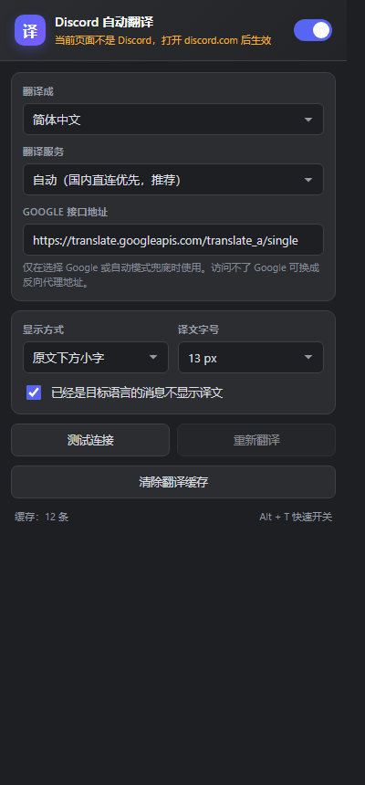

# Discord 自动翻译

把 Discord 里的英文、日文、韩文、俄文等消息自动翻译成中文，译文以带「译」标记的小字显示在原文下方。原文完整保留，随时对照。

> **直接下载** ｜ [最新版本](https://github.com/1584776265/discord-translator/releases/latest) · exe 5 MB，安装包 2 MB
> 不需要 Node.js、Python 或任何运行时，Win10 1803+ 开箱可用



四种形态共用同一套翻译引擎与 DOM 适配逻辑：

| 形态 | 适用场景 | 前置条件 |
| --- | --- | --- |
| **桌面应用（Tauri）** | Discord 桌面客户端，**推荐** | 无，双击 exe |
| **浏览器扩展** | Discord 网页版 | 无 |
| **BetterDiscord 插件** | 已装 BD 的桌面用户 | BetterDiscord |
| **Node 启动器** | 旧版，保留作调试对照 | Node.js 18+ |

---

## 一、桌面应用（Tauri，推荐）

原生 exe，不修改 Discord 任何文件，不依赖 BetterDiscord / Vencord，Discord 更新也不会失效。


**体积**：exe 5.05 MB，NSIS 安装包 2.07 MB。WebView2 运行时 Win10 1803+ 系统自带。

**全程无控制台窗口**：exe 是 GUI 子系统（连 debug 构建也是），并且程序内部**不 spawn 任何控制台程序** —— 进程枚举、终止进程、发 WM_CLOSE、读写 .lnk 全部直接走 Win32 API，不再调 `tasklist` / `taskkill` / `powershell`。这些命令即使加了 `CREATE_NO_WINDOW`，在部分机器上也会闪一下黑窗。

### 安装

运行 `desktop/src-tauri/target/release/bundle/nsis/DiscordTranslator_1.1.0_x64-setup.exe`。

per-user 安装到 `%LOCALAPPDATA%\Programs\DiscordTranslator`，不弹 UAC。

> 未签名，首次运行会撞 SmartScreen 蓝色提示：点「更多信息」→「仍要运行」。这是没买代码签名证书的正常现象。

### 使用

1. 双击桌面上的 **Discord 自动翻译**
2. 首次点【连接 Discord】——如果 Discord 正在运行会**重启它一次**（要开调试端口），语音会断、草稿会丢
3. 连接成功后译文自动出现，关闭窗口仍在托盘运行

### 发送前翻译（Alt + Enter）

在 Discord 输入框里打完中文，按 **`Alt + Enter`**，会把它翻成目标语言并替换输入框内容——**不会自动发出去**，你检查完再按 Enter 发送。

设置里可以改「翻成」（默认英语）、开启「翻译后直接发送」、或者整个关掉这个功能。

技术细节：Discord 的输入框是 Slate.js 编辑器，直接改 DOM 会被 React 覆盖。实测三种写法里：
- `beforeinput` 事件 —— Slate 会拦掉，什么都不插入（无效）
- `paste` 事件 —— 能触发 Slate 的粘贴逻辑，但在完全空的编辑器上偶尔不生效
- `execCommand('insertText')` —— 最稳，且会触发 input 事件同步 React 状态

所以主用 `execCommand`，失败再用 `paste` 兜底。

> 注意：`execCommand` 在**文档没有焦点**时会静默失败，所以必须 Discord 窗口是激活的。你按 Alt+Enter 时本来就在 Discord 里，所以正常场景没问题。

### 划词翻译

一条消息只翻了半句你想要的？直接**选中那几个词**，选区旁边会冒出一个蓝色「译」按钮，点它只翻这段，译文弹在选区下面，点空白处关掉。

- 只在消息正文里出现，输入框、成员列表、频道列表都不会冒按钮
- 用独立的 `bridge.translate` 单条请求，不会覆盖整条消息的译文，也不影响消息的翻译状态
- 结果走同一套缓存，同一段文字点第二次是内存命中
- 设置里可以整个关掉

### 自动更新

设置里「版本更新」卡片：显示当前版本、是安装版还是便携版，一个【检查更新】按钮，启动 8 秒后还会静默查一次。

**安装版**（注册表里有卸载项、且当前 exe 就在安装目录里）点【下载并安装】后：

1. 取 GitHub 最新 Release 的 `*_x64-setup.exe` 与 `sha256.txt`
2. 下载到 `%TEMP%\DiscordTranslatorUpdate\`，算 SHA-256 与发布页比对，**不一致直接放弃**
3. 把 `config.json` 备份成 `config.json.bak-<旧版本>`
4. 写一个一次性 `apply.bat`：等本进程退出 → `setup.exe /S`（NSIS 静默覆盖安装，旧版本文件由安装器自行清理）→ 重新拉起程序
5. 进程退出，安装完自动重新打开

配置与数据都在 `%APPDATA%\DiscordTranslator\`（`config.json`、`store.db` 缓存），安装器不碰这个目录，所以**术语表、白名单、API Key、缓存全部原样保留**；万一目录被清掉，启动时还会自动从 `config.json.bak-*` 恢复最近一份。

**便携版**不做自动替换（运行中的 exe 覆盖不了，批处理替换又容易被杀软拦），只提示有新版本并给出【打开下载页】。

没有用 `tauri-plugin-updater` 的原因：那套要长期保管 minisign 私钥并塞进 CI secret，私钥丢了就再也发不出更新；这里改用发布页自带的 `sha256.txt` 做完整性校验，零密钥，代价是信任链绑在 GitHub 账号上。

GitHub API 对匿名访问限速 60 次/小时/IP，被限流时自动退回「不跟随重定向、从 `Location` 头读版本号」的探测方式（不消耗额度），所以国内共享出口也能用。

### 本地翻译引擎（LibreTranslate / Ollama，一键引导部署）

设置里有「本地翻译引擎」区块，两个按钮，点哪个都能把翻译搬到你自己机器上：不联网、不花钱、没有额度限制。

**为什么不做成内置的？** LibreTranslate = Python 运行时（约 60MB）+ Argos 语言模型（每个语言对 100–200MB），完整部署 400MB 起步；Ollama + 3B 模型约 2.5GB。本程序 exe 只有 5MB，塞进去等于直接击穿体积红线，而且每次更新都要重发几个 GB。所以做成"引导式部署"：引擎文件由 Docker / winget 自己管理缓存，exe 里只放按钮和状态机。

#### 部署 LibreTranslate（需要 Docker）

1. 检测 Docker 是否安装并运行，没有就给出明确指引（**不会静默失败**）
2. `docker pull libretranslate/libretranslate`（首次约 1GB）
3. `docker run -d --name discord-translator-libre --restart unless-stopped -p 5000:5000`
4. 等端口就绪（首次要加载语言模型，约 1–2 分钟）
5. 成功后**自动切到 LibreTranslate 并填好地址**

#### 部署 Ollama（不需要 Docker）

1. 检测 `ollama` 命令和 `%LOCALAPPDATA%\Programs\Ollama\ollama.exe`
2. 没装就用 `winget install --id Ollama.Ollama -e --silent` 静默安装（没有 winget 则给出官网下载链接）
3. 启动 `ollama serve` 并等待 11434 端口
4. `ollama pull qwen2.5:3b`（约 2GB，视网速 5–20 分钟）
5. 成功后**自动切到 OpenAI 兼容模式**，Base 填 `http://127.0.0.1:11434/v1`，模型 `qwen2.5:3b`

> 默认选 `qwen2.5:3b` 是因为它在 CPU 上也能跑到 10–20 tokens/s，翻译一条 20 字的消息约 2–3 秒。有独显的话可以把模型换成 `qwen2.5:7b`（约 4.7GB）质量更好。

两个部署都在**后台线程**跑，界面每 1.5 秒轮询一次进度，显示当前阶段（拉镜像 / 启动服务 / 拉模型）而不会卡住窗口。

#### 状态与卸载

部署完不是黑盒：每个引擎都有一块独立面板，显示**已装什么、占多少磁盘**，也能删掉。

| 引擎 | 状态显示 | 卸载做什么 | 不会做什么 |
| --- | --- | --- | --- |
| LibreTranslate | 运行中/已停止、语言包数量与语言列表（`en, zh`）、镜像体积 | `docker rm -f discord-translator-libre` + `docker rmi` 删镜像（约 1GB） | 不卸载 Docker Desktop，不动别的容器 |
| Ollama | 运行中/已停止、每个模型的名称与体积 | `ollama rm <model>` 删模型文件（约 2GB） | 不卸载 Ollama 本体，不动别的模型 |

Docker Desktop 装了但没启动时，面板显示「Docker 未运行」并禁用卸载按钮 —— 读不到容器状态不等于没装，这时报「未部署」会误导人。

### 术语表

设置里可以维护 `原文=译文` 的术语表，也可以点【加载推荐术语】一键导入游戏/显卡/MOD 圈的常用词（17 条）。

**实测效果**（腾讯源）：

```
不加术语：新补丁固定了纹理流流问题, 请更新您的图形驱动程序
加术语后：新的补丁修复了这个纹理流送问题，请更新您的显卡驱动。
```

**两套机制，按引擎自动分流**：

| 引擎类型 | 术语表怎么生效 | 实测命中率 |
| --- | --- | --- |
| **腾讯 / 大厂 API** | 占位符替换：`<0>` 替换 → 翻译 → 还原 | 5/5 用例，术语 7/7 |
| **DeepSeek / Ollama（LLM）** | 术语写进 **user 消息**的「术语参考」 | 7/7，且句子更自然 |
| **LibreTranslate** | ❌ 无法支持 | 0/7 |

为什么 LLM 不用占位符：替换会把句子拆开，译文会变生硬。实测同一句话：

```
占位符方案 → 新的补丁「解决了」纹理流送的问题…当着色器缓存「为空」时
提示词方案 → 新的补丁「修复了」纹理流送的问题…当着色器缓存「冷却」时   ← 更准更顺
```

**踩过的坑**：一开始把 17 条术语堆进 system prompt，结果 **qwen2.5:3b 直接忘了「保留 `[数字]` 前缀」的格式要求**，整批报“模型漏译”。改成把术语放在 user 消息开头、system 只留一句提醒，才恢复正常。小模型的指令跟随能力有限，prompt 越长越容易失控。

为什么 LibreTranslate 不行：Argos 是逐词对齐的统计模型，不是 LLM。实测 `<0>` → `" 0 "`、`[texturestreaming]` → `[纹理流`，任何标记都只是普通文本。**这是模型架构决定的，不是实现问题**。程序检测到占位符被改写时会提示一次，不会悄悄给你错译文。

### 接管 Discord 图标（重要）

默认情况下，你直接双击 Discord 图标启动的客户端**没有调试端口**，翻译完全不工作。

界面里有个「Discord 图标」区块，点【接管 Discord 图标】后，桌面和开始菜单的 Discord 快捷方式会指向本程序，本程序再转发启动 Discord —— 于是你点原来的图标就能正常翻译。

- 接管会**备份原始 TargetPath** 到 `%APPDATA%\DiscordTranslator\shortcut-backup.json`
- 随时可以用【还原为原版】改回去（已实测往返无损）
- 卸载前请先点一次还原

### 原理

Discord 桌面版是 Electron 应用。本程序用 `--remote-debugging-port` 拉起它，并通过 Chrome DevTools Protocol 连上渲染进程，把 DOM 适配层注入进去。

翻译请求由**本程序（Rust + WebView 前端）发出**，不走页面 —— Discord 页面的 CSP `connect-src` 只放行 discord.com，页面里直接请求第三方接口会被拦。

CDP 的 WebSocket 有 Origin 校验，所以启动 Discord 时带 `--remote-allow-origins=http://tauri.localhost`（只放行本程序，不用 `*`）。

### 已实现的功能

| 功能 | 说明 |
| --- | --- |
| 连接状态面板 | 状态灯、已翻译/当前消息/今日请求/翻译源四个指标 |
| **断线自动重连** | Discord 重启后自动恢复；若它重启时没带调试端口，会发系统通知提示你手动恢复 |
| **首次关窗口提示** | 第一次点关闭时通知「已最小化到托盘，翻译仍在运行」，只提示一次 |
| **当前频道一键白名单** | 自动读出当前频道名，一个按钮就能「只翻译这个频道 / 加入 / 移出白名单」，不用手抄频道 ID |
| 翻译缓存 | SQLite 落盘，30 天 TTL，重启不重翻、不重烧 API |
| 用量统计 | 今日请求次数 + 每日上限（超限停止并提示） |
| 失败可见 | 先静默重试一次，仍失败才在消息下方红标「翻译失败：原因」+【重译】；本地模型把原文吐回来也按失败处理，不当成译文渲染 |
| **翻译源健康度** | 诊断区显示各源实时连通性和耗时，一眼看出哪个挂了 |
| **额度自动踢出** | 某个源额度耗尽时自动移出降级链并显示恢复倒计时，不白发请求 |
| **本地引擎一键部署** | 引导式部署 LibreTranslate（Docker），或接本地 Ollama |
| **本地引擎状态与卸载** | 显示已装语言包 / 已装模型及体积，可一键删容器、镜像或模型 |
| **自动更新** | 从 GitHub 取最新版，校验 `sha256.txt` 后静默覆盖安装并自动重启；配置与术语表原样继承 |
| **中英双语界面** | 设置里可切 中文 / English / 跟随系统，Rust 与前端两侧文案都跟着走 |
| **划词翻译** | 选中消息里任意一段文字，点旁边「译」单独翻译，不重译整条消息 |
| **长消息自动分段** | 超过引擎安全长度的消息按段落/句子切开翻译再拼回，避免静默截断和超时 |
| **发送前翻译** | Discord 输入框里按 `Alt + Enter`，把要说的话翻成目标语言填回输入框 |
| 范围控制 | 频道白名单、忽略指定用户（作者名命中即跳过） |
| 术语表 | `原文=译文`，翻译前用私有区字符占位、翻译后还原；支持导入/导出 txt |
| **多版本支持** | 稳定版 / PTB / Canary 三个渠道任选 |
| **界面主题** | 跟随系统 / 强制深色 / 强制浅色 |
| **缓存分级清理** | 全部清空，或只清 7 天前的 |
| 托盘常驻 | 关窗口不退出，托盘菜单可暂停/继续/退出 |
| **退出清理** | 从托盘退出时会把注入到 Discord 的译文清掉，不留"僵尸译文" |
| 快捷方式接管 | 见上 |
| 日志 | `%APPDATA%\DiscordTranslator\logs\app.log`，2 MB 自动轮转 |

### 配置

`%APPDATA%\DiscordTranslator\config.json`（界面里的设置会写回这里）：

| 字段 | 说明 | 默认 |
| --- | --- | --- |
| `cdpPort` | 调试端口，被占用会自动顺延 | `9223` |
| `targetLang` | `zh-CN` / `zh-TW` / `en` / `ja` … | `zh-CN` |
| `provider` | `auto` / `tencent` / `google` / `caiyun` / `mymemory` / `openai` / `libre` | `auto` |
| `dailyRequestLimit` | 每日请求上限，0 = 不限 | `0` |
| `channelWhitelist` | 频道 ID 列表，空 = 全部翻译 | `[]` |
| `glossary` | 术语表 `[{from, to}]` | `[]` |
| `theme` | `system` / `dark` / `light` | `system` |
| `channel` | `stable` / `ptb` / `canary` | `stable` |
| `selectionTranslate` | 选中消息文字时显示「译」按钮 | `true` |
| `language` | 界面语言：`auto` / `zh` / `en` | `auto` |
| `autoCheckUpdate` | 启动后静默检查更新 | `true` |
| `updateProxy` | 更新用代理，空 = 读系统代理，`direct` = 直连 | `""` |
| `composerTranslate` / `composerAutoSend` / `outgoingLang` | 发送前翻译 | `true` / `false` / `en` |

### 安全性

调试端口只监听 `127.0.0.1`，但**本机任何程序都能连上去执行任意 JS**（等于能读你的 Discord token）。这是 CDP 方案的固有代价，不是实现缺陷。介意的话把端口改成不常见的值，不用时退出程序。

---

## 二、浏览器扩展（网页版）

1. 打开 `chrome://extensions`（Edge 是 `edge://extensions`），开启**开发者模式**
2. **加载已解压的扩展程序** → 选 `extension` 目录
3. 打开 <https://discord.com/channels/@me> 并刷新
4. 点工具栏「译」图标确认开关打开

按 `Alt + T` 快速开关。



> 从 `dist/DiscordTranslator-extension.zip` 安装要先解压。Chrome 不允许直接装未上架的 zip。

---

## 三、BetterDiscord 插件（备选）

```powershell
cd betterdiscord
powershell -ExecutionPolicy Bypass -File .\install-bd.ps1
```

复制插件到 `%APPDATA%\BetterDiscord\plugins\`，备份并更新 `plugins.json`，把 `Translator` / `AutoTranslate` 设为关闭（避免同一消息出现几份译文，`-KeepOtherTranslators` 可保留）。

### 已知问题：BD 会被 Discord 更新打掉

BD 的原理是修改 `resources\app.asar`。Discord 每次更新都新建 `app-1.0.xxxx` 目录，**BD 的注入就失效了** —— 表现为插件列表还在，但没有任何效果。

判断：

```powershell
Get-ChildItem "$env:LOCALAPPDATA\Discord\app-*\resources" | Select-Object Name, LastWriteTime
```

`app.asar` 的修改时间等于 Discord 构建日期（而不是你装 BD 的时间）就是没注入。

修复：重新安装 [BetterDiscord](https://betterdiscord.app/)。本项目的插件在 `betterdiscord/DiscordTranslator.plugin.js`，修好 BD 后自动加载。

> 本机实测：Discord 已更新到 `app-1.0.9266`，`app.asar` 仍是原始构建时间，BD 当前未注入。这种情况请用桌面应用方案。注意客户端内必须走 `BdApi.Net.fetch`（原生 fetch 会被 Discord 的 CSP 拦），这一点已经在 engine.js 里处理。

---

## 四、Node 启动器（旧版）

```powershell
双击 启动Discord翻译.bat
```

功能与桌面应用一致，但需要装 Node.js、只有黑窗口、没有 GUI。保留它是因为它是最早验证可行性的实现，出问题时可以拿来对照。

---

## 五、翻译源怎么选

默认 **自动**，按顺序降级：

| 顺序 | 翻译源 | 特点 |
| --- | --- | --- |
| 1 | 腾讯交互翻译 | 国内直连、免 Key、支持批量（一次 40 条），英/日/韩/中互译质量好 |
| 2 | MyMemory | 国内直连，几乎不失效，任意语言对，有每日额度 |
| 3 | 彩云小译 | 国内直连，用的是公开 demo token，容易被限流 |
| 4 | Google 翻译 | 质量最好，国内需要代理 |

**能上 Discord 通常也能访问 Google**，可以在设置里手动切到 Google，效果最好。

想用大模型（更懂游戏术语）选 `OpenAI 兼容`：Base 填 `https://api.deepseek.com/v1`（或本地 Ollama `http://127.0.0.1:11434/v1`），模型 `deepseek-chat`。会一次打包 25 条发送，比逐条便宜得多。

---

## 六、它是怎么工作的

```
Discord 页面
   │  MutationObserver 监听消息列表变化
   ▼
dom.js  扫描 li[id^="chat-messages-"] → 提取 message-content 文本
   │      跳过代码块、spoiler、回复引用
   ▼
CDP binding 把文本送回宿主进程
   ▼
engine.js（WebView / Node / Service Worker 三种宿主共用）
   │      本地语种检测 → 按语言分组 → 同语言批量请求
   ▼
翻译源  tencent / mymemory / caiyun / google / openai / libre
   │      失败自动降级；结果写入内存 LRU + SQLite
   ▼
dom.js  在 message-content 后面插入 <div class="dt-trans">
```

几个关键设计：

- **语种分组**：腾讯接口的自动检测只认批次第一条的语言，混合语言整批发过去会把韩语翻成乱码。先用 Unicode 字符区间本地分组，再按组批量。
- **长文本分段**：实测腾讯超过约 1800 字会**静默截断**（3500 字只回 540 字译文），本地 `qwen2.5:3b` 在 CPU 上超过 3000 字直接超时。所以按引擎给不同安全长度（腾讯/Google 1500、Libre/OpenAI 兼容 1200），先按空行切段、再按句子切、实在不行硬切，分段翻完用空行拼回去；任一段失败就报失败，不给半截译文。
- **虚拟列表兼容**：Discord 的消息 `li` 会被 React 复用，每条译文都记着 `data-dt-for`（消息 ID）和 `data-dt-src`（原文），`li` 换消息或消息被编辑时自动重译。
- **CSP**：三个宿主各自绕开 —— 扩展走 background service worker，BD 走 `BdApi.Net.fetch`，桌面应用走 Rust 的 `reqwest`。

---

## 七、常见问题

**Q：译文不出现？**
- 桌面应用：确认程序还开着（关窗口会收到托盘）。看「诊断」里的日志，或点【测试翻译源】。
- 扩展：确认开关打开、页面刷新过。
- BD：先确认 BD 本身还在工作。

**Q：只有部分消息有译文？**
正常。会跳过：已经是目标语言的消息、纯代码块、纯表情/太短、spoiler 内容。

**Q：翻译质量差？**
腾讯源对日韩英中互译不错，欧洲语言一般，俄语会自动切 MyMemory。追求质量用 Google 或 DeepSeek。

**Q：会不会把聊天内容发出去？**
会，这是任何翻译工具的前提。介意的话切到本地 Ollama。

**Q：Discord 更新后失效？**
桌面应用不受影响（不碰 Discord 文件）。BD 插件会受影响，需重装 BD。

**Q：`--remote-allow-origins` 会不会有安全风险？**
只放行 `http://tauri.localhost` 与 `http://localhost:1420`（本程序的 WebView），不是 `*`。恶意网页的 Origin 不同，连不上。

---

## 八、目录结构

```
discord-translator/
├── desktop/                        # Tauri 桌面应用
│   ├── src/                        # 纯静态前端（零 npm 运行时依赖）
│   │   ├── index.html
│   │   ├── app.js                  # CDP 客户端 + 注入 + 翻译桥
│   │   ├── style.css
│   │   ├── engine.js               # 构建时从 extension 同步
│   │   ├── dom.js                  # 构建时从 extension 同步
│   │   └── content.css             # 构建时从 extension 同步
│   └── src-tauri/
│       ├── Cargo.toml
│       ├── tauri.conf.json
│       └── src/
│           ├── lib.rs              # 命令注册、托盘、窗口事件
│           ├── config.rs           # 配置读写
│           ├── discord.rs          # 启动/停止/端口/进程检测
│           ├── http.rs             # HTTP 代理（绕 CORS）
│           ├── store.rs            # SQLite 缓存 + 用量
│           ├── shortcut.rs         # 快捷方式接管/还原
│           ├── local_engine.rs     # 本地引擎引导部署
│           ├── uninstall.rs        # 本地引擎状态查询与卸载
│           └── logging.rs
├── extension/                      # 浏览器扩展
│   └── src/core/                   # engine.js / dom.js / settings.js（单一真源）
├── launcher/                       # Node 版启动器（旧）
├── betterdiscord/                  # BD 插件
├── 启动Discord翻译.bat              # Node 版入口
├── build/
│   ├── build-desktop.ps1           # 同步共享模块 + tauri build
│   ├── build.ps1                   # BD 插件 + 扩展 zip
│   └── make-desktop-icon.ps1
└── test/                           # mock 页面、CDP 驱动脚本
```

## 九、开发

```powershell
# 桌面应用（release + NSIS 安装器）
powershell -ExecutionPolicy Bypass -File .\build\build-desktop.ps1

# 只出 exe 不打包
powershell -ExecutionPolicy Bypass -File .\build\build-desktop.ps1 -NoBundle

# 扩展 zip + BD 插件
powershell -ExecutionPolicy Bypass -File .\build\build.ps1

# 引擎单测（不需要浏览器）
node test/engine.test.js
```

`build-desktop.ps1` 会把 `extension/src/core/{engine,dom}.js` 与 `content.css` 同步到 `desktop/src/`，保证三种形态用同一份代码。

调试桌面应用：用 `WEBVIEW2_ADDITIONAL_BROWSER_ARGUMENTS=--remote-debugging-port=9555` 启动，就能用 CDP 检查前端状态。

### 自动构建

`.github/workflows/build.yml`：push `v*` tag 时在 `windows-latest` 上出一份 exe + NSIS 安装包，并直接以 tag 建 Release（正文取 `RELEASE_NOTES.md`）。手动 `workflow_dispatch` 只上传 artifact，不发版。
